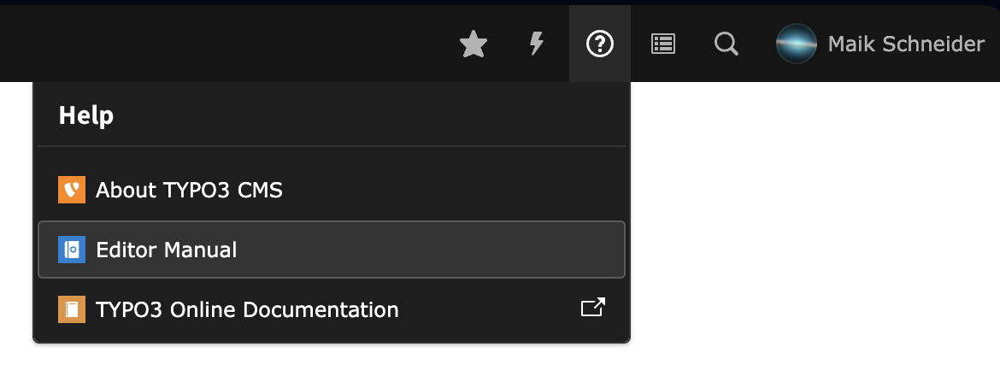
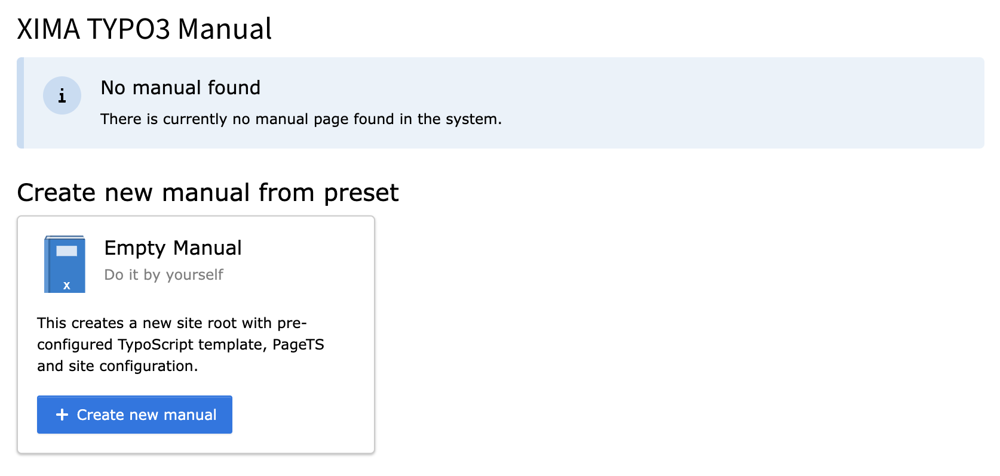

# Configuration

This extension works like a sitepackage. You can configure it manually or use
the installation wizard to create from a preset.

## From Preset

When opening the Manual modal the first time, you will be asked to create a new
manual from a preset. This will create a new page tree with the necessary
configuration:

## Manual Configuration

* Start with creating a new page in the page tree
* Select Type "**Manual page**"
* Check "**Use as Root Page**"
* Create a site configuration for that page and add the site set "**XIMA Manual**"
(`xima/manual`) under *Dependencies*

Installations that predate site sets can keep the previous wiring instead: include
the **static PageTS** "XIMA Manual" and create a root TypoScript template that
includes the static TypoScript of this extension.

## Customization

The site set `xima/manual` brings its settings along, so they can be edited per
site under *Site Management > Sites > Settings*:

| Setting | Default | Effect |
|---|---|---|
| `manual.appearance.primaryColor` | `#1A5FB4` | Lead colour: links, markers, active states |
| `manual.appearance.showNavigation` | enabled | Shows the chapter navigation sidebar. Turn it off to hide it entirely |
| `manual.appearance.showToc` | enabled | Shows the "Contents" / "On this page" column. Turn it off to hide it entirely |
| `manual.appearance.showContentInNavigation` | disabled | Lists content-element headers in the navigation tree too, not just chapter pages — how navigation worked before it became chapter-only. Combine with `showToc` off for that original look |
| `manual.behaviour.displayFullManual` | enabled | Renders every chapter on one page. Turn it off to show one chapter per page, with the chapter list linking to the pages instead of anchors |
| `manual.navigation.faqPage` | none | Page linked from the "FAQ" entry above the navigation. Leave empty to hide the entry |
| `manual.navigation.changelogPage` | none | Page linked from the "Changelog" entry above the navigation. Leave empty to hide the entry |

* Logo: the `media` field of the manual root page, falling back to the backend
login logo
* Manual title: the `websiteTitle` of the site configuration is used
