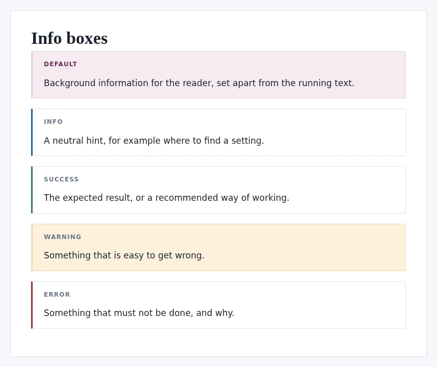
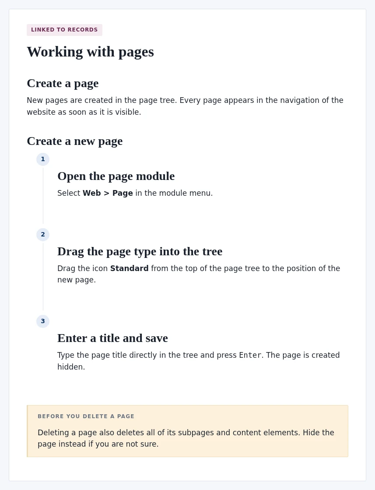
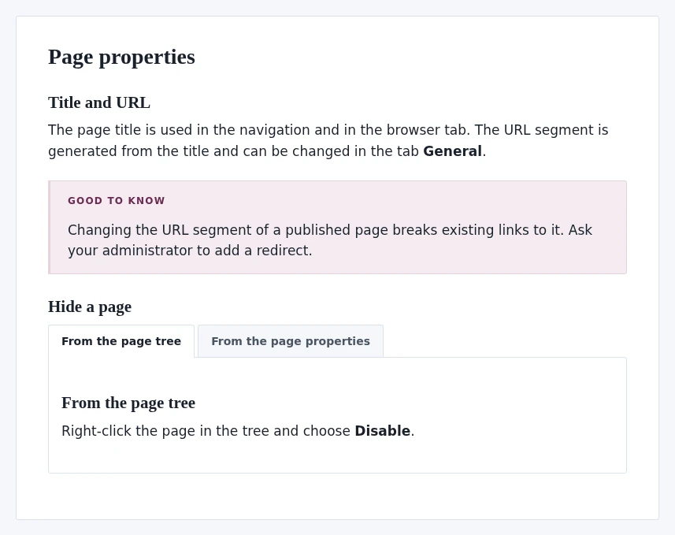
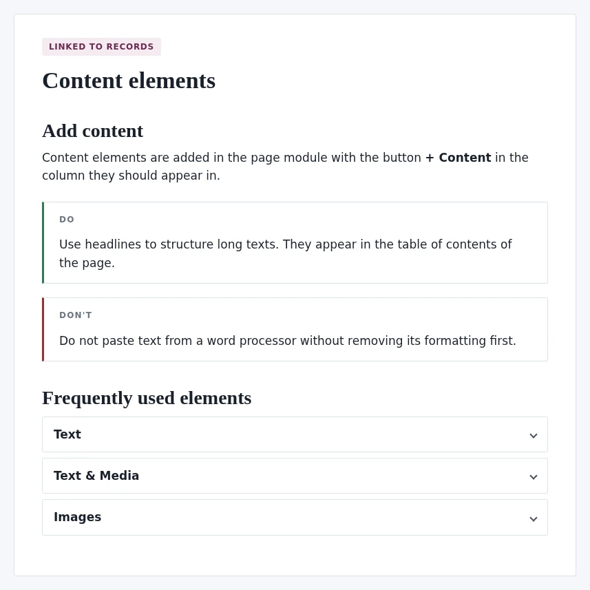
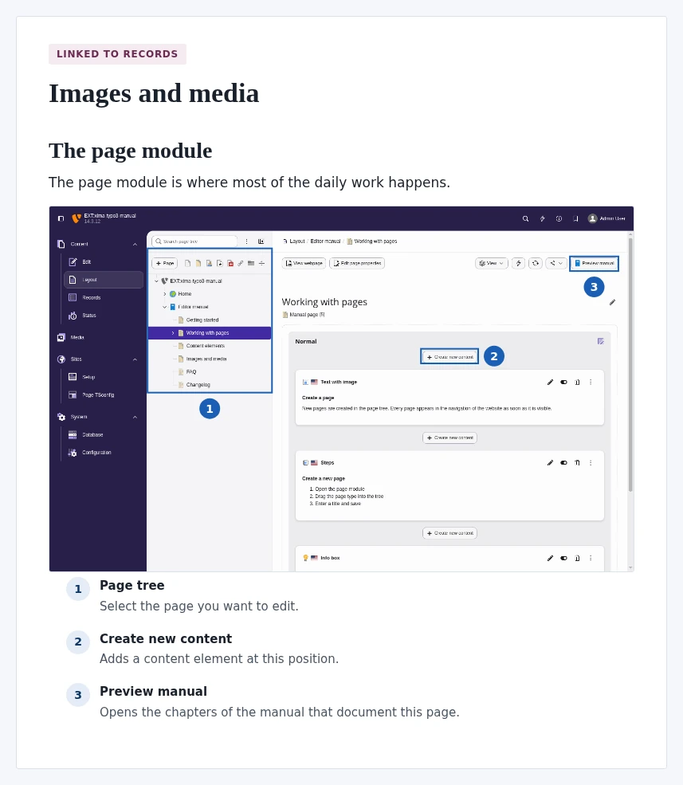

..  _content-elements:

================
Content elements
================

The manual's page TSconfig limits the content wizard to four dedicated types.
These are the supported authoring elements, rather than every element installed
by the surrounding website.

Text with image (mtext)
======================

Enter a heading and rich text, with an optional image from the file storage.
The page TSconfig allows one image and a limited set of image positions. The
RTE supports emphasis, lists, links, tables, styles and TYPO3 icons through
EXT:bw_icons. Use the icon picker instead of copying icon HTML from elsewhere.

Images in this element can be opened in a lightbox. Supply useful alternative
text in the image/file metadata; a screenshot should also have instructions in
text so it is understandable without the image.

Info box / note (mbox)
======================

Use :guilabel:`Info box` for short notes. Its :guilabel:`Style` selects:

..  list-table::
    :header-rows: 1

    *   - Backend label
        - Layout value
        - Rendering
    *   - Default
        - ``0``
        - Editorial, plum background
    *   - Info
        - ``1``
        - Blue accent
    *   - Success
        - ``2``
        - Green accent
    *   - Warning
        - ``3``
        - Sand background
    *   - Error
        - ``4``
        - Red accent

The optional heading is rendered inside the block; the required body is rich
text. Notes are not chapter headings in the "on this page" list.

Steps (msteps)
==============

Create a :guilabel:`Steps` element, give it a heading and add child elements in
its inline list. Children default to text-with-image elements. Sort them in that
list, not as separate elements in the normal column.

:guilabel:`Display as` provides four layouts:

*   :guilabel:`Roadmap` (``0``): numbered steps with a connecting line.
*   :guilabel:`Accordion` (``1``): expandable panels.
*   :guilabel:`Tabs` (``2``): one child panel per tab.
*   :guilabel:`Slider` (``3``): one child panel at a time with controls.

The PDF flattens every layout to a linear list, so no hidden panel is lost.

Annotated image (mannotation)
=============================

The image-with-focus-points element uses EXT:bw_focuspoint_images. Add an image,
then use its focus-point editor on the file reference to place points or marked
rectangles. Each point can have a title and description. The manual's TSconfig
adds the :guilabel:`Default` and :guilabel:`Marking` types and a marker-position
selector for markings (left, right, top, bottom or inside).

The frontend shows the numbered markers over the image and a matching description
list below it. Open the image to view its lightbox. The primary site colour is
used for the markers.

        their explanations below.

Glossary, FAQ and changelog
==========================

There is no dedicated glossary content type. Create a chapter called "Glossary"
and use text-with-image elements with one term per heading, or a rich-text table
for short definitions. Do not look for a glossary plugin in the content wizard.

FAQ and changelog are ordinary manual pages selected by
``manual.navigation.faqPage`` and ``manual.navigation.changelogPage``. The
quicklinks are hidden until a target is configured. Add entries as text elements
and use their headings for the question or change title.
