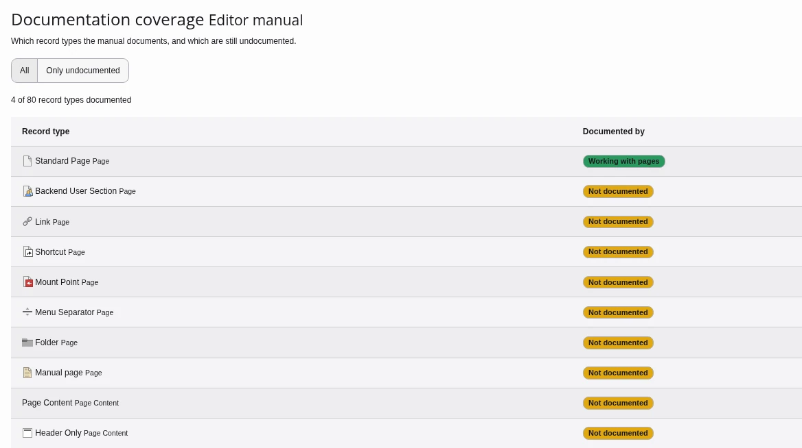

..  _related-records:

==========================
Related records & coverage
==========================

Open the :guilabel:`Related records` tab of a manual chapter or manual content
element. Select the record types that the instructions describe, for example a
standard page or a text-with-media content element. These are assignments to
**types**, not to one individual record UID.

When an editor opens a matching record, the docheader's manual button offers the
associated chapters or elements. The instructions open in a modal without
replacing the record form. If several manuals match, the links are grouped by
manual. Manuals without read access are filtered out.

If nothing is assigned for the current record, the manual button opens the
manual rather than a context-specific chapter. Within the manual's own page tree
it becomes a preview button.

Coverage report
===============

Choose :guilabel:`Coverage` in the manual module's docheader. The report lists
the record types known to the registry and the chapters/elements assigned to
them. :guilabel:`Only undocumented` filters the list to gaps. The report is per
manual.

This measures assignments, not the correctness or completeness of the prose.
Use it to find missing topics, not as a substitute for editorial review.

The author needs access to the relation exclude fields; see :ref:`access`.
Projects can exclude extra tables from the selector/report in
:ref:`configuration`.
