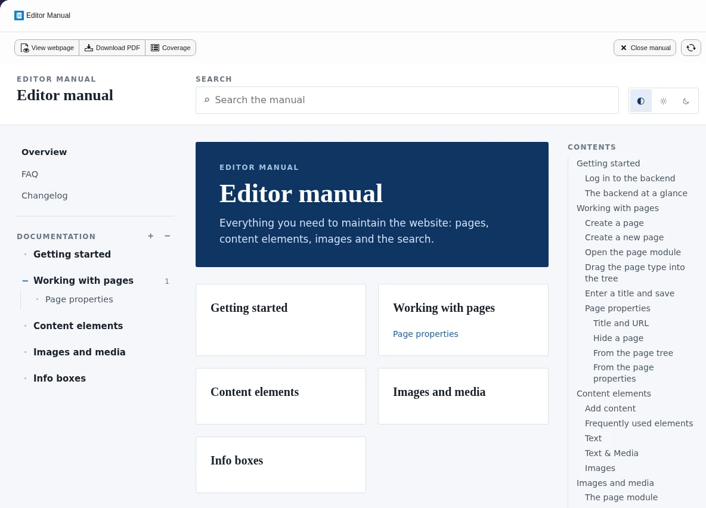

..  _start:

=======================
Editor manual for TYPO3
=======================

:Extension key:
    xima_typo3_manual
:Package name:
    xima/xima-typo3-manual
:Version:
    |release|
:Language:
    en
:Author:
    XIMA MEDIA GmbH & Contributors
:License:
    GPL-2.0-or-later
:Rendered:
    |today|

Create editor manuals as TYPO3 page trees and read them in the backend.
Chapters can document record types, so editors can open the relevant instructions
without leaving the record they are working on.

        content and table of contents.

    The manual is a frontend site, embedded in the backend module.

..  card-grid::
    :columns: 1
    :columns-md: 2
    :gap: 4
    :card-height: 100

    ..  card:: :ref:`Introduction <introduction>`

        Features and how the manual fits into a TYPO3 installation.

    ..  card:: :ref:`Installation <installation>`

        Requirements, Composer installation and the first manual.

    ..  card:: :ref:`Configuration <configuration>`

        Site set, all site settings and access rules.

    ..  card:: :ref:`Editor guide <editor-guide>`

        Chapters, notes, steps, images and related records.

    ..  card:: :ref:`Customization <customization>`

        Branding, design tokens and Fluid overrides.

    ..  card:: :ref:`Developer guide <developer>`

        DDEV, tests, quality checks and custom presets.

..  toctree::
    :maxdepth: 2
    :titlesonly:
    :hidden:

    Introduction/Index
    Installation/Index
    Configuration/Index
    EditorGuide/Index
    MultipleManuals/Index
    Search/Index
    PdfExport/Index
    VisualEditor/Index
    Customization/Index
    Upgrade/Index
    Developer/Index
    KnownProblems/Index
