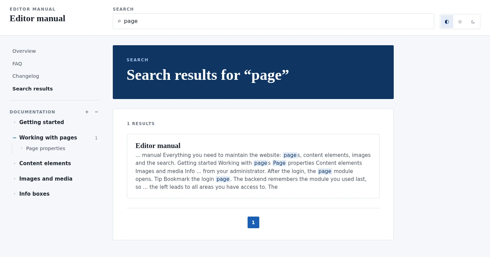

..  _search:

======
Search
======

The site set includes EXT:indexed_search and enables indexing for normal
frontend requests:

..  code-block:: typoscript

    config.index_enable = 1
    config.index_externals = 0

The form submits to the manual root. Results use the
``IndexedSearch / ManualResults`` plugin and the manual's own templates rather
than requiring an extra search-plugin content element. Search-result pages are
uncached. Backend preview requests with ``context=backend`` and the printable
page type have indexing disabled.

Building the index
==================

1.  Apply the database schema so the indexed-search tables exist.
2.  Visit the manual through its normal frontend URLs, without
    ``context=backend``. A backend-only preview does not build the index.
3.  For one-chapter-per-page mode, visit each chapter URL too.
4.  Search for a word present in the rendered content.

Indexing happens when an eligible frontend page is rendered, not when an editor
saves a content element. With full-manual mode, one indexed page can contain all
chapters: expect a result for that page rather than one result per content
heading. The index is not a live query of ``tt_content``.

No or stale results
===================

Check that you visited the public frontend and that ``config.index_enable`` is
not overridden by another template. Review the indexed-search index and its
minimum reindexing age; an existing entry may not be refreshed on every request.
Use indexed_search's index-management tools when rebuilding an index after a
large content or URL change.

If the manual is private, include its search-result URLs in the same web-server
protection as the content. Do not rely on backend page permissions to protect the
frontend search output.
