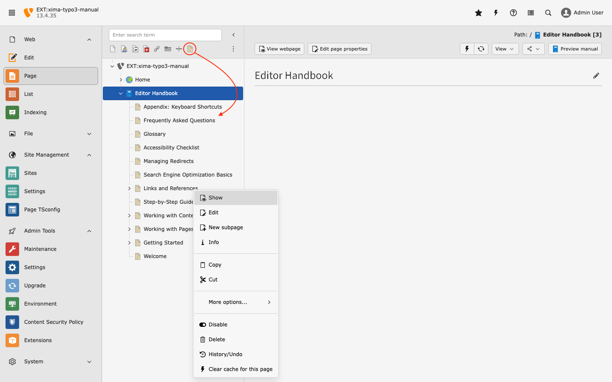
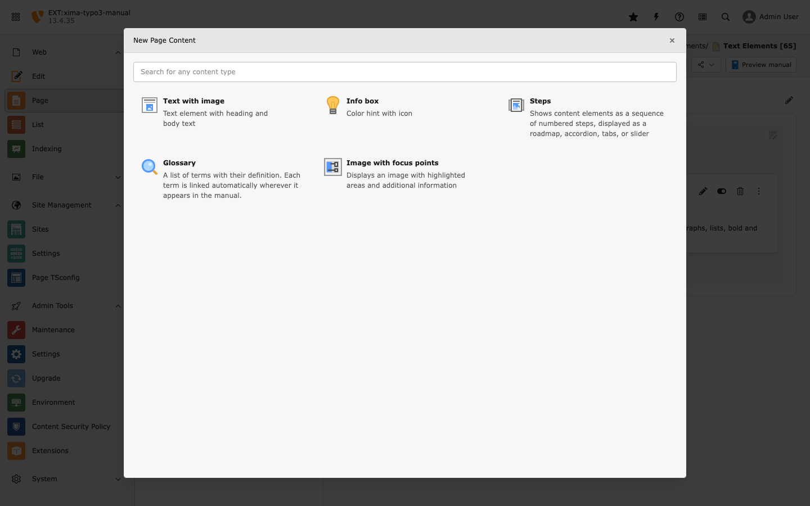
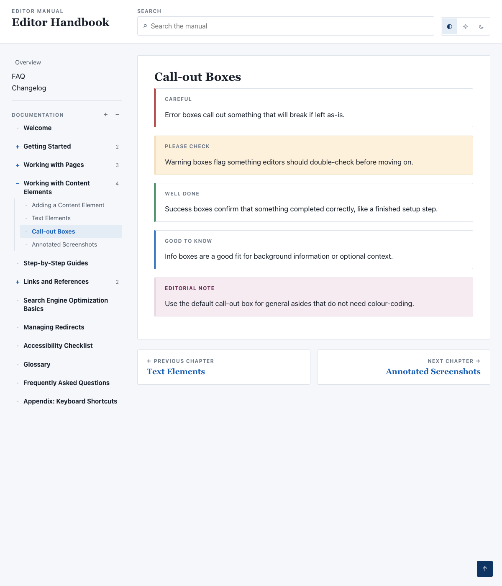
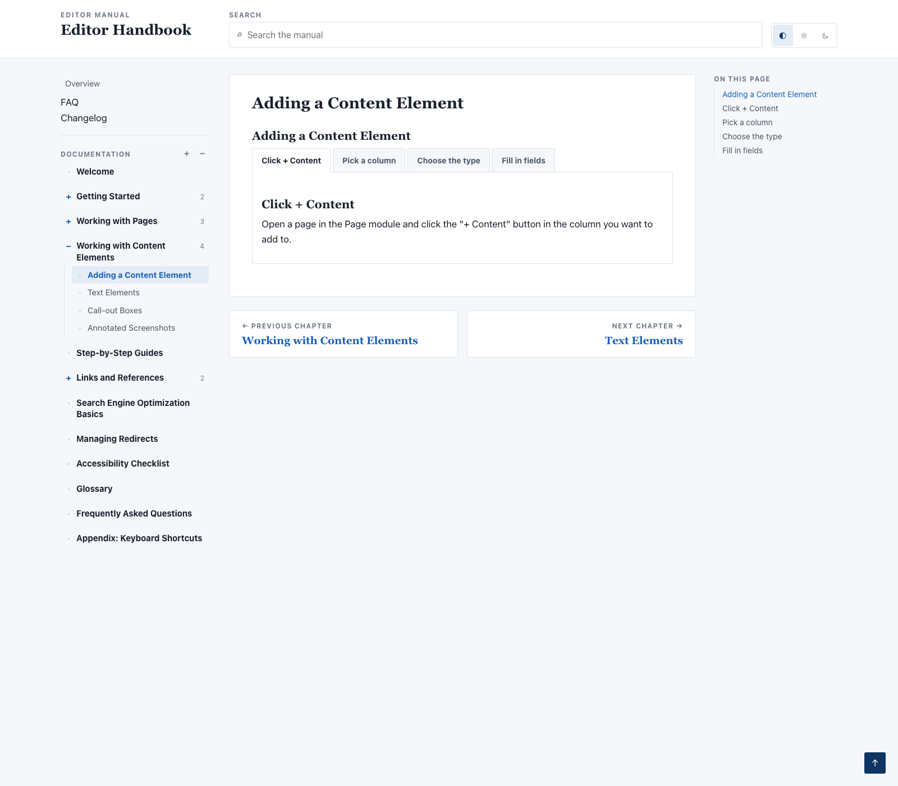
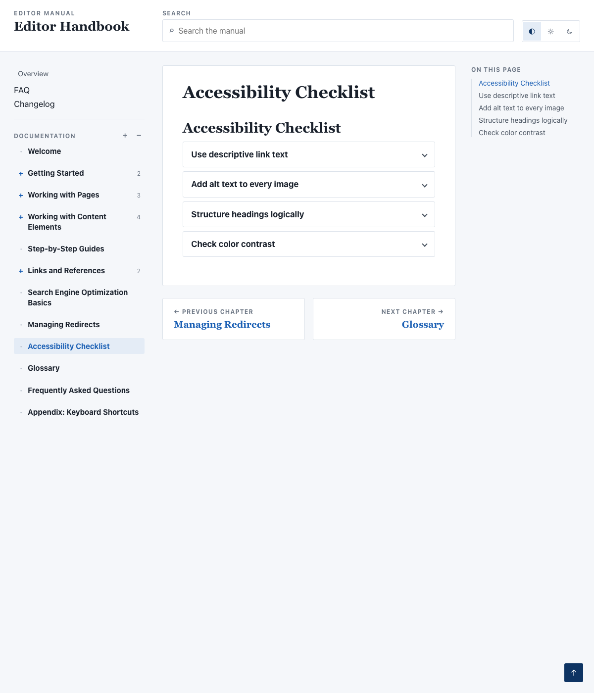
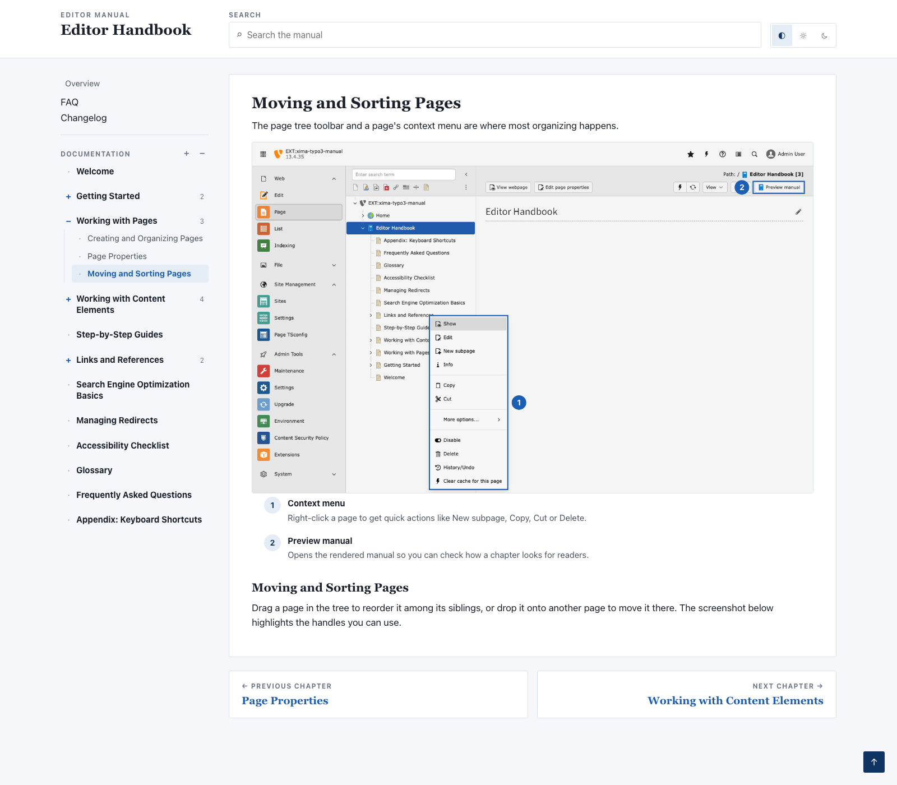
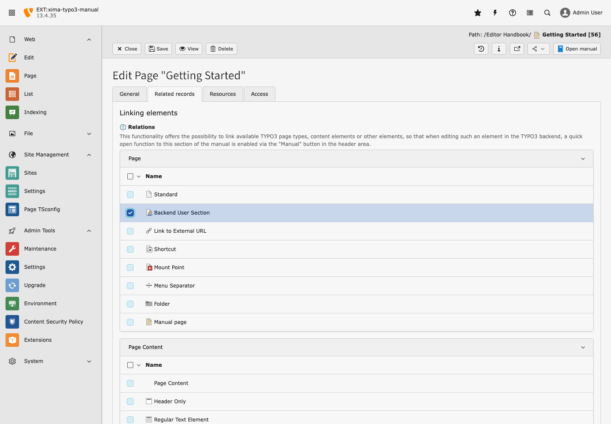
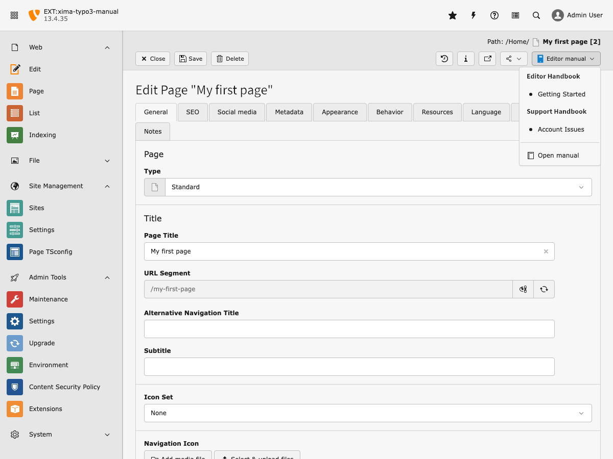

# Usage

## Create a new chapter

Create chapters by adding new pages with the doktype "**Manual page**":



Add content elements to the pages to fill the chapters:



## Content elements

Besides the standard TYPO3 content elements, this extension ships four of its
own, purpose-built for documentation:

* **Text with image** — a heading and body text, with an optional image
* **Info box** — a highlighted aside in five colour variants: default, info,
success, warning, error



* **Steps** — a sequence of content elements, displayed as a roadmap,
accordion, tabs, or slider




* **Image with focus points** — an image with highlighted areas and
call-out text, powered by
[bw_focuspoint_images](https://extensions.typo3.org/extension/bw_focuspoint_images)



## Link chapters to records

You can link chapters to records by selecting the record types in the **Related
records**
tab of manual pages and text elements:



If manual elements are found while editing a record, a dropdown button will
appear in the doc header, grouped by manual when there is more than one.
These links are opened in a modal:



## Visual editing

With [`friendsoftypo3/visual-editor`](https://github.com/FriendsOfTYPO3/visual_editor)
installed, chapter headings and texts can be edited inline in the backend module
*Web > Edit*, in the layout the reader sees:

```bash
composer require friendsoftypo3/visual-editor
```

Nothing else has to be configured. The extension is optional; without it the
manual renders exactly as before.

One limitation is worth knowing: a manual renders its whole page tree on a single
page, while the visual editor takes the page that new elements are added to from
the request. Adding, moving and deleting elements therefore works in the chapter
that is the requested page — open `Web > Edit` on that chapter to edit its
structure. Editing existing headings and texts works in every chapter.

## Several manuals

An installation can hold any number of manuals: create one manual page tree per
manual, each with its own site configuration. The backend module then shows a
manual selector in its doc header, remembers which manual you read last, and the
manual button of every other module groups the chapters it found by the manual
they belong to. Manuals a backend user has no page permissions for are hidden
from both.
