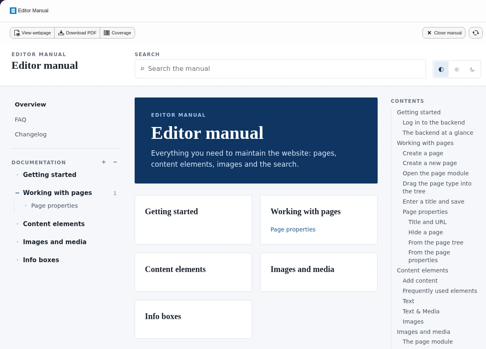
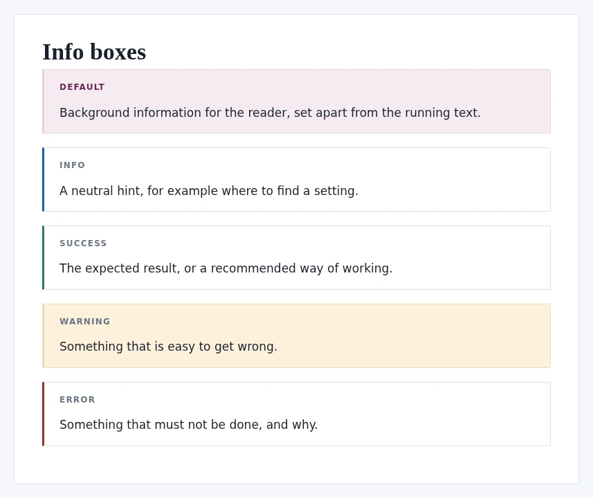
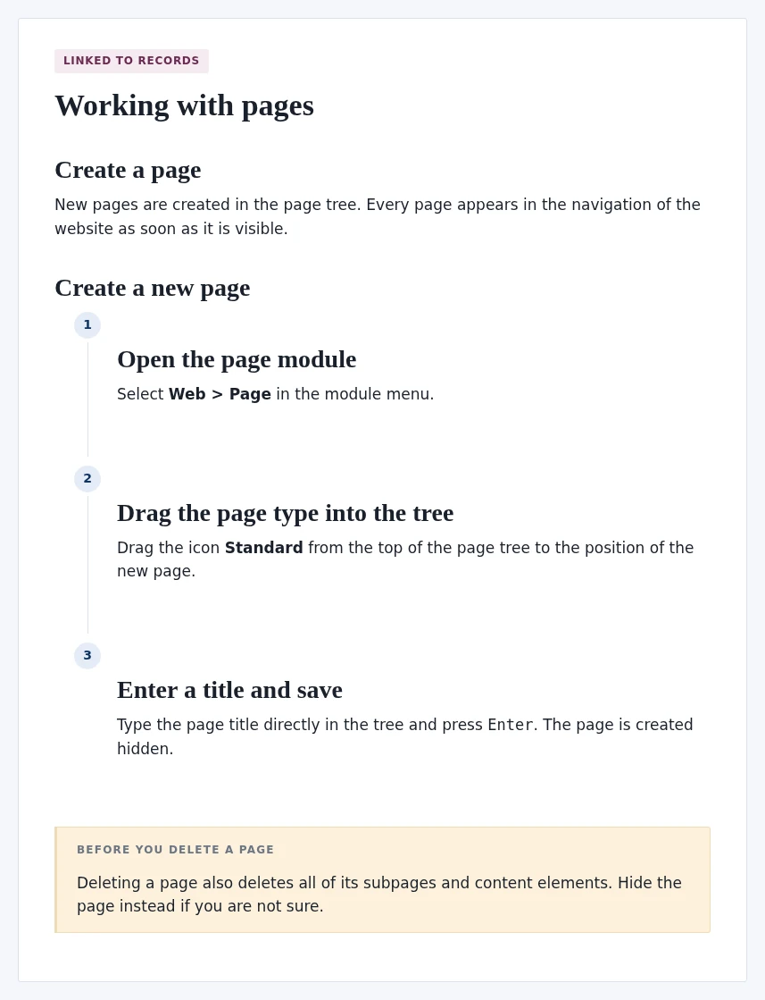
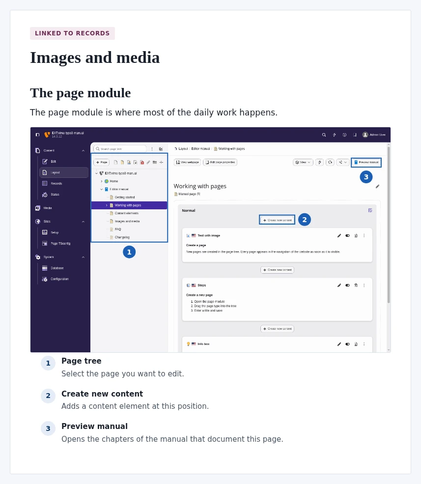

<div align="center">


# TYPO3 extension `xima_typo3_manual`

[](https://extensions.typo3.org/extension/xima_typo3_manual)
[](https://extensions.typo3.org/extension/xima_typo3_manual)
[](https://packagist.org/packages/xima/xima-typo3-manual)
[](https://github.com/xima-media/xima-typo3-manual/actions/workflows/tests.yml)
[](https://github.com/xima-media/xima-typo3-manual/actions/workflows/sca.yml)
[](https://codecov.io/gh/xima-media/xima-typo3-manual)
[](https://github.com/xima-media/xima-typo3-manual/actions/workflows/documentation.yml)

</div>

Create editor manuals as TYPO3 page trees and read them in the backend. Link chapters to record types so editors can open the right instructions while editing a record.



## Features

* Chapters with rich text, images, tables and TYPO3 icons
* Five note styles and step-by-step guides as a roadmap, accordion, tabs or slider
* Annotated screenshots with [bw_focuspoint_images](https://extensions.typo3.org/extension/bw_focuspoint_images)
* Related-record links, a documentation coverage report and multiple manuals
* Full-text search with indexed_search and a backend PDF download
* Site settings for colour, navigation and one-page or chapter-by-chapter reading; self-hosted fonts and light/dark modes
* Optional inline editing with [EXT:visual_editor](https://github.com/FriendsOfTYPO3/visual_editor)

### Notes and step-by-step instructions





### Annotated screenshots



## Requirements

| Extension | TYPO3 | PHP |
|-----------|-------|-----|
| 3.0 | 13.4.29+ or 14.3 LTS | ^8.2, within TYPO3's supported range |

Composer installs the required system extensions, bw_icons, bw_focuspoint_images and dompdf. For older extension versions, see the [release history](https://github.com/xima-media/xima-typo3-manual/releases).

## Installation

```bash
composer require xima/xima-typo3-manual
```

Apply the database schema, flush caches, then open **Editor Manual** as an administrator to create the first manual. Alternatively, create a root page of type **Manual page**, give it a site configuration and add the site set:

```yaml
dependencies:
  - xima/manual
```

The manual is a frontend site, **not private just because it is shown in the backend**. Protect confidential manuals at the web server, including their printable view and files. The PDF download separately requires a backend login and page read access.

## Documentation

Read the [extension documentation](https://docs.typo3.org/p/xima/xima-typo3-manual/main/en-us/Index.html): [installation](https://docs.typo3.org/p/xima/xima-typo3-manual/main/en-us/Installation/Index.html), [site settings](https://docs.typo3.org/p/xima/xima-typo3-manual/main/en-us/Configuration/SiteSettings.html), [editor guide](https://docs.typo3.org/p/xima/xima-typo3-manual/main/en-us/EditorGuide/Index.html) and [upgrade from 2.x](https://docs.typo3.org/p/xima/xima-typo3-manual/main/en-us/Upgrade/Index.html).

The RST sources are in [`Documentation/`](Documentation/Index.rst). Composer is recommended; see the [classic-installation limitation](https://docs.typo3.org/p/xima/xima-typo3-manual/main/en-us/KnownProblems/Index.html) before using the TER ZIP.

## Contributing

See [CONTRIBUTING.md](CONTRIBUTING.md) for DDEV, tests and quality checks. Report security issues according to [SECURITY.md](SECURITY.md).

## License

[GNU General Public License 2.0 or later](LICENSE.md).
