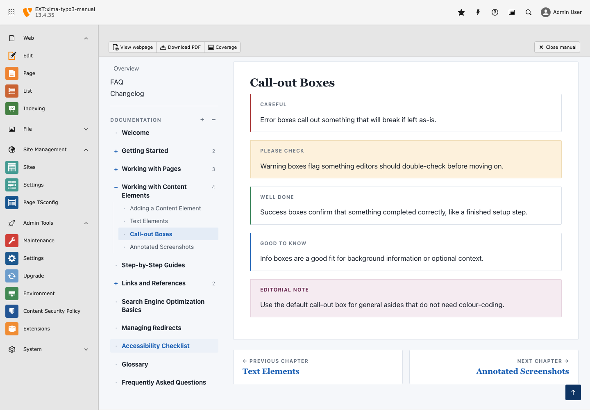

<div align="center">


# TYPO3 extension `xima_typo3_manual`


[](https://extensions.typo3.org/extension/xima_typo3_manual)

[](https://packagist.org/packages/xima/xima-typo3-manual)

</div>

This extension is a sitepackage, designed for the creation of user manuals.
Administrators can easily create chapters by adding TYPO3 page records with a
special doktype.



## Features

* Backend module with preview
* Its own design system: serif headings, a configurable lead colour (calm blue by default) and self-hosted fonts
* Full text search over the whole manual
* Call-out boxes in five colour variants: default, info, success, warning, error
* Step-by-step guides: a sequence of content elements shown as a roadmap, accordion, tabs, or slider
* Documentation coverage report: which record types are documented, and which are not
* Several manuals side by side, for example one per editor role or per website
* Associate individual chapters to TYPO3 records for easy access
* Directly open chapters in a modal while editing records
* PDF download
* Annotate screenshots with image editor:
See [bw_focuspoint_images](https://extensions.typo3.org/extension/bw_focuspoint_images)
* TYPO3 system icons available in RTE:
See [bw_icons](https://extensions.typo3.org/extension/bw_icons)

## Compatibility

| TYPO3      | PHP         | Extension |
|------------|-------------|-----------|
| 14.3 LTS   | 8.2 – 8.5   | 2.1+      |
| 13.4 LTS   | 8.2 – 8.4   | 2.1+      |
| 12.4 LTS   | 8.1 – 8.3   | 2.0.x     |

## Installation

### Composer

```bash
composer require xima/xima-typo3-manual
```

### TER

[](https://extensions.typo3.org/extension/xima_typo3_manual)

Download the zip file from
[TYPO3 extension repository (TER)](https://extensions.typo3.org/extension/xima_typo3_manual).

## Documentation

* [Configuration](Documentation/Configuration.md) — site setup, presets, settings
* [Usage](Documentation/Usage.md) — chapters, content elements, visual editing, linking records
* [Developer](Documentation/Developer.md) — local development setup, contributing

## Contribute

You want to customize more? Open an issue or create a pull request!

Please have a look at [`CONTRIBUTING.md`](CONTRIBUTING.md).

## License

This project is licensed
under [GNU General Public License 2.0 (or later)](LICENSE.md).
